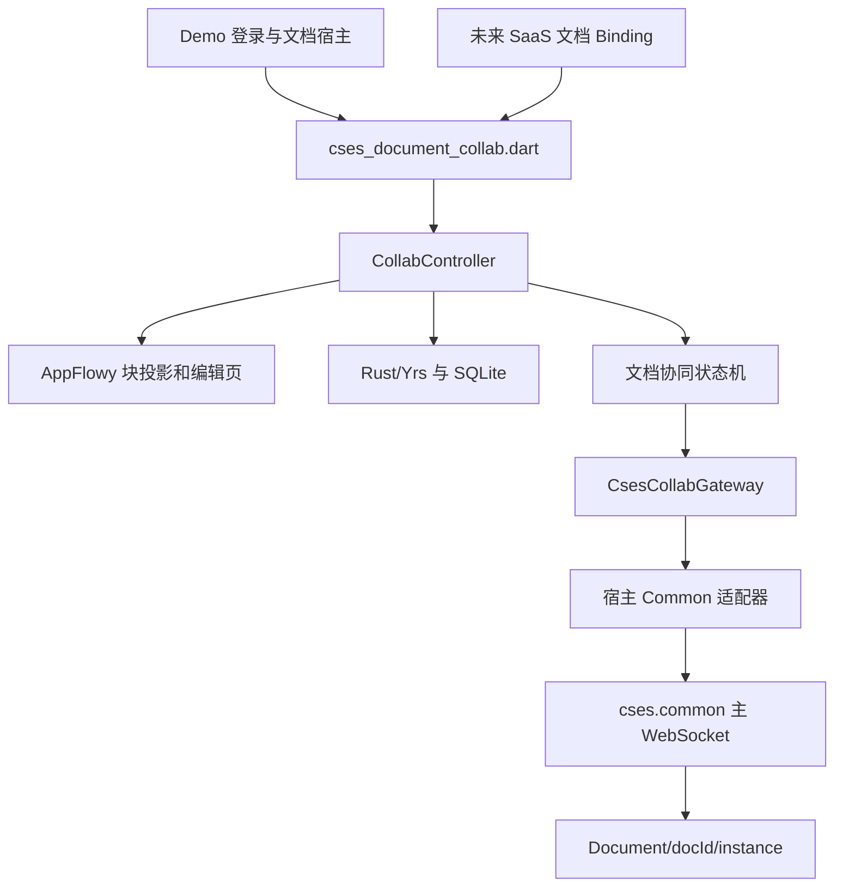

# 协同包接入与迁移

当前实现：`packages/cses_document_collab` 是独立 Flutter FFI 插件包；根项目是使用其公开 API 的 Demo 宿主。包可以整体移入 `cses.saas/packages/cses_document_collab` 或独立仓库。业务路由和 Common 主连接由未来宿主装配。

## 引用链与边界

包不读取 `ctx`、`User`、`Config`，不发起 HTTP 登录，不创建/关闭物理 WebSocket，不选择宿主缓存目录。移动后包内无需修改业务 import 或原生库源码路径。包内无引用 demo/Common/SaaS 的 import；AppFlowy fork 通过同级 `../appflowy_editor` 引用，其 `diff_match_patch`、`scroll_to_index` 直接使用 pub.dev 发布版本。内部 `cses_mobile_*` 常量是旧草稿的持久化格式，必须保留兼容。

宿主提供：

| 能力 | 当前 Demo 实现 | 后续 SaaS 接入 |
|---|---|---|
| 登录与连接上下文 | CsesAccountLogin 通过 Common HttpManager 登录并初始化 User/ctx；CsesDemoHost 直接使用当前上下文 | 已有登录与企业上下文 |
| 数据库路径 | DemoDocumentHost 选择旧路径 | Binding 注入应用支持目录内路径 |
| Gateway | CommonCsesCollabGateway | 文档模块 Infrastructure 实现同一接口 |
| 日志/ID | Common Log.e/ObjectId 的回调 | Binding 注入已有日志/ID 能力 |
| 本地媒体上传 | CsesEditorMediaUploadService | 注入当前认证下的 OSS/资源登记实现 |
| 正文编辑权限 | Demo 显式 editable=true | 读取服务端权限后注入并监听撤销 |
| 主连接恢复 | DemoDocumentHost 前台监听 | 已有 WebSocketLifecycleOwner |

Demo 的登录配置和设备信息先于 Common HTTP 初始化；登录成功响应只交给 `User().resolveContext`，不由文档宿主重新解析或覆盖。登录完成只通知页面切换，不创建独立会话对象，账号和展示名直接读取 `User`。文档宿主在创建控制器时直接从 `User/ctx` 构造 `CollabDocumentConfig`；服务端、企业和用户身份在该配置中形成不可变快照，Cookie 始终留在 Common，缓存键只由协同包计算。失败重试和页面销毁不得留下半完成的身份；登录响应迟到时须在注入前检查页面有效性。Common HTTP、主连接及 OSS/资源登记共享同一登录上下文。

正式与草稿是显式构造方式。Demo 默认使用 Common 当前上下文打开正式文档，离线预览和测试显式设置 `localDraft: true`。正式文档初始化直接恢复 BlockCraft 分区并开始文档握手；草稿沿用旧私有结构，并由宿主传入默认封面。正式文档不会先加载 demo-room、创建业务根或补写草稿头部。

## 资源与异步生命周期

DemoDocumentHost 创建包控制器并监听其状态；页面只借用控制器。进入编辑页前完成 initialize，本地恢复完成后文档仍可能等待网络握手。退出账号时先 `await host.close()`：等待迟到的宿主初始化、文档订阅、原生 Doc 关闭和正在执行的连接恢复，再关闭 Demo 持有的主连接并清理认证。返回连接面板不释放控制器。

包以进程占用保护匹配 Rust 单 Doc 限制。另一个控制器在 touching SQLite/Doc 前抛 `COLLAB_DOCUMENT_IN_USE`；失败控制器的 close 不会关闭当前控制器的 Doc。close 等待初始化、权限切换和已排队投影，随后释放占用。

`setEditable(false)` 立即关闭本地编辑能力，并串行释放/重建文档会话。只读同步应用远端 update，但回传空 V1 update，不上传本地缓存中的未同步修改；重新授权后通过向量同步补传。模型只读同时禁止写入和编号自动修复。媒体服务仍可能在网络端完成上传，但过期/只读弹窗不会把结果写入正文。该控制不是服务端安全边界。

`resync()` 保留权限/Schema 等终止错误，适用于主连接恢复；`retry()` 是用户主动重试。清缓存只影响当前分区，随后由 retry 重新加入。ready/online 不等于数据库 ACK；服务端落库、业务更新时间、搜索和桌面互通须另行联调。

Common 适配器沿用已有 onlyListen+手动 subscribe 策略；注册/注销 async void 通过公开锁形成完成屏障。接口的同步发送异常仍可能入队，向量同步修复正文；join/leave/Awareness 的重放和生产订阅策略须在真实环境专项验证。

## 数据兼容

Demo SQLite 路径仍为应用支持目录下 `cses_mobile_collab_demo/updates.sqlite3`。正式缓存键保持 `cses-blockcraft-v1:SHA256(JSON([websocketUrl, companyId, userId, documentId]))`，cookie 不参与。宿主传入 Common 解析的完整 WS 地址作为 serverIdentity；默认协议也遵循 Common，不在 Demo 强制改写。若地址与历史 Demo 不同则使用对应分区，保留旧分区，不将不同服务身份的离线增量自动合并。Rust 接收正式 docId 和独立缓存键，保留未知原生属性、修订结构与不支持块的数据。

块清单仍以 [block-adaptation.md](block-adaptation.md) 为准：8 已适配、8 部分支持、1 结构支持、24 未适配。上传功能由宿主注入；当前 Demo 保留上传进度、取消、重试和插入位置保护，包未配置上传服务时只提供 URL。

## 平移到 SaaS

1. 整目录移动/引用本包，在 `cses.saas/pubspec.yaml` 添加 path 或固定版本依赖。
2. 将本项目 `packages/` 中的 appflowy_editor 一并迁移并保留同级目录结构，解析同一 AppFlowy 6.2.0 fork；diff_match_patch、scroll_to_index 由 pub.dev 解析，无需迁移本地包。若单独移动协同包，在最终 App（例如 cses.jqdl）的 dependency_overrides 指向可用的 fork。库层的 override 不代替最终 App 的 override。
3. 在文档模块注册编辑路由与 Binding，从一次路由快照取得正式 docId、企业/用户/服务端身份和数据库路径。
4. 复用当前 Common 连接实现 Gateway；适配器参考本 Demo 的 `lib/src/demo/common_cses_collab_gateway.dart`，只拥有文档注册。配置 host services 使异常继续进入统一日志，并可注入现有上传实现。
5. 确认正文编辑权限契约后创建 CollabDocumentConfig。当前移动端 modify 字段表示元数据修改；服务端编辑策略仍需明确 allowEdit 与 allowRename 的关系，不能仅按角色或 companyId 推断正文授权。
6. 由 Binding/页面宿主创建控制器，完成 initialize 后显示 CollaborativeEditorPage。权限变化调用 setEditable；企业/账号/docId 变化先等待 close，再创建新控制器。
7. iOS 最终 App 构建前调用包内 tool/build_rust_ios.sh；Android 通过插件传递依赖和 Cargokit 构建。不得将 demo 的宽松网络安全配置作为包配置。

## 构建、生成和验证

原 rust_builder 的 Android、iOS 和 Cargokit 已合并入本包；Dart 插件名称为 cses_document_collab，原生库名称仍为 cses_collab_core。SPM 产品名、podspec、Cargo 路径与 FRB 输出配置已按新目录同步。桥接代码使用 FRB 2.13.0 生成；Cargo.lock 随包固定原生依赖。iOS XCFramework、构建输出、临时 package overrides 均不提交。

验证入口：根目录 `flutter test test` 覆盖认证与 Common 回环；包目录 `cargo build/cargo test/flutter test` 覆盖编辑、Schema 和真实 FRB；`tool/verify_portable_package.sh /path/to/appflowy_editor` 复制包至无关目录，再从另一个宿主仅通过公开入口加载、渲染与重开 SQLite。iOS/Android 从实际 Demo App 构建，验证传递依赖打包。

2026-10-14 当前宿主直接注入文档配置的验证：根宿主 16 项测试、相关静态检查和 Android debug 构建通过。缓存兼容测试固定迁移前的真实键，不再比较两套缓存计算实现；主连接地址校验由登录边界验证 Common 当前上下文。Android 16 真机登录后实际文档配置与 Common 身份/地址一致；图片和视频通过系统选择器上传、文件登记、OSS 哈希回读、服务端独立空向量回读及一秒视频播放验收。详见 [OSS 联调记录](oss-upload-integration.md)。

2026-10-14 此前登录接入阶段的自动验证（真机复验之前）：根宿主 18 项测试通过，覆盖 Common 请求 header、上下文解析、企业偏好、失败重试、页面销毁迟到响应、文档初始化失败后的退出清理与真实 Socket 回环；本次涉及的 App 和测试静态检查无问题。全仓分析另有旧 build_tool 构建路径错误和 AppFlowy/示例的既有提示，未纳入本次修改。真实账号和真机上传未在本次重新验收。

2026-10-14 包迁移阶段已完成验证：

| 项目 | 结果 |
|---|---|
| 根宿主测试 | 14 项通过，含登录、旧缓存身份与真实 Common 回环 |
| 协同包 Dart/Flutter 回归 | 601 项通过，含实际 FRB 和新增占用/只读/恢复门禁 |
| Rust | 60 项通过，0 忽略 |
| 静态分析 | 根 App 和包均无问题 |
| FRB 生成 | 2.13.0 成功生成，生成代码与原 ABI 保持一致 |
| 异地引用 | 复制包后，独立宿主的 2 项公开 API/渲染测试通过 |
| iOS | 设备及模拟器 XCFramework 成功，最终 Demo 模拟器 App 构建成功，已确认包含 cses_collab_core.framework |
| Android | Demo assembleDebug 成功，APK 包含新包的 libcses_collab_core.so；使用本次构建专用 Maven 镜像 |

原生 libc 固定为 0.2.186，解决 backtrace 使用的 iOS dyld 声明在 0.2.190 中被限制到 macOS 的兼容问题。Android 默认 Google Maven 下载存在 TLS 故障，本机使用一次性 Gradle init 脚本将 Google Maven 指向 Aliyun 镜像，项目仓库配置不变。真实 PRE 双设备、真实账号上传、服务端权限撤销和落库未由本机回归代替；CocoaPods 配置随包保留，当前以 SPM 构建为验证对象。
