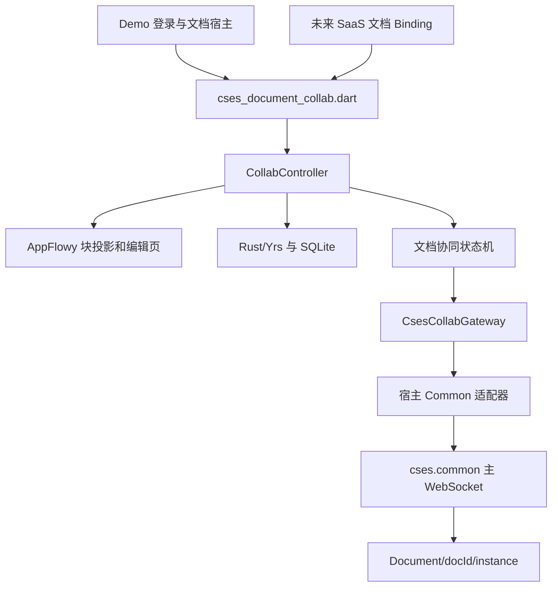

# 协同包接入与迁移

当前实现：`packages/cses_document_collab` 是独立 Flutter FFI 插件包；根项目是使用其公开 API 的 Demo 宿主。包可以整体移入 `cses.saas/packages/cses_document_collab` 或独立仓库。业务路由和 Common 主连接由未来宿主装配。

## 引用链与边界

包不读取 `ctx`、`User`、`Config`，不发起 HTTP 登录，不创建/关闭物理 WebSocket，不选择宿主缓存目录。移动后包内无需修改业务 import 或原生库源码路径。包内无引用 demo/Common/SaaS 的 import；AppFlowy fork 通过同级 `../appflowy_editor` 引用，其 `diff_match_patch`、`scroll_to_index` 直接使用 pub.dev 发布版本。内部 `cses_mobile_*` 常量是旧草稿的持久化格式，必须保留兼容。

宿主提供：

| 能力 | 当前 Demo 实现 | 后续 SaaS 接入 |
|---|---|---|
| 登录与连接上下文 | CsesAccountLogin 通过 Common HttpManager 登录并初始化 User/ctx；CsesDemoHost 直接使用当前上下文 | 已有登录与企业上下文 |
| 数据库路径 | DemoDocumentHost 选择旧路径 | Binding 注入应用支持目录内路径 |
| Gateway | CommonCsesCollabGateway | 文档模块 Infrastructure 实现同一接口 |
| 日志/ID | Common Log.e/ObjectId 的回调 | Binding 注入已有日志/ID 能力 |
| 正式文档头部 | CsesDocumentMetadataService 经 Common HttpManager 读取详情/权限及修改名称/图标/封面 | 注入 DocumentMetadataService，保存与正文 Yjs 分离 |
| 本地媒体上传 | CsesEditorMediaUploadService | 注入当前认证下的 OSS/资源登记实现 |
| 正文编辑权限 | Demo 显式 editable=true | 读取服务端权限后注入并监听撤销 |
| 主连接恢复 | DemoDocumentHost 前台监听 | 已有 WebSocketLifecycleOwner |

Demo 的登录配置和设备信息先于 Common HTTP 初始化；登录成功响应只交给 `User().resolveContext`，不由文档宿主重新解析或覆盖。登录完成只通知页面切换，不创建独立会话对象，账号和展示名直接读取 `User`。文档宿主在创建控制器时直接从 `User/ctx` 构造 `CollabDocumentConfig`；服务端、企业和用户身份在该配置中形成不可变快照，Cookie 始终留在 Common，缓存键只由协同包计算。失败重试和页面销毁不得留下半完成的身份；登录响应迟到时须在注入前检查页面有效性。Common HTTP、主连接及 OSS/资源登记共享同一登录上下文。

正式与草稿是显式构造方式。Demo 正式模式使用 Common 当前上下文先初始化账号服务与主 WebSocket，不选择文档或占用原生文档引擎；从文档列表选择后才创建控制器。离线预览和测试显式设置 `localDraft: true`。选中文档的控制器初始化直接恢复 BlockCraft 分区并开始文档握手；草稿沿用旧私有正文结构，不再创建封面/标题块；旧草稿自动清除这两个块并保留正文。正式文档不会先加载 demo-room、创建业务根或补写草稿头部。

## 资源与异步生命周期

DemoDocumentHost 在列表选择或新建文档后创建包控制器并监听其状态；页面只借用控制器。普通打开先通过 `/doc/document/view` 核验访问，再串行释放旧文档、恢复所选文档；同一已初始化文档复用控制器及撤销历史。进入编辑页前完成控制器 initialize，本地恢复完成后仍可能等待网络握手。编辑页从列表路由推入，返回保留列表位置；初始化及前台恢复都不会自动打开默认或最近创建文档。退出账号时先 `await host.close()`：等待迟到的宿主初始化、文档订阅、原生 Doc 关闭和正在执行的连接恢复，再关闭 Demo 持有的主连接并清理认证。返回连接面板不释放控制器。

包以进程占用保护匹配 Rust 单 Doc 限制。另一个控制器在 touching SQLite/Doc 前抛 `COLLAB_DOCUMENT_IN_USE`；失败控制器的 close 不会关闭当前控制器的 Doc。close 等待初始化、头部进行中的读写、权限切换和已排队投影，随后释放占用。

`setEditable(false)` 立即关闭本地编辑能力，并串行释放/重建文档会话。只读同步应用远端 update，但回传空 V1 update，不上传本地缓存中的未同步修改；重新授权后通过向量同步补传。模型只读同时禁止写入和编号自动修复。媒体服务仍可能在网络端完成上传，但过期/只读弹窗不会把结果写入正文。该控制不是服务端安全边界。

`resync()` 保留权限/Schema 等终止错误，适用于主连接恢复；`retry()` 是用户主动重试。清缓存只影响当前分区，随后由 retry 重新加入。ready/online 不等于数据库 ACK；服务端落库、业务更新时间、搜索和桌面互通须另行联调。

Common 适配器沿用已有 onlyListen+手动 subscribe 策略；注册/注销 async void 通过公开锁形成完成屏障。接口的同步发送异常仍可能入队，向量同步修复正文；join/leave/Awareness 的重放和生产订阅策略须在真实环境专项验证。

## 数据兼容

Demo SQLite 路径仍为应用支持目录下 `cses_mobile_collab_demo/updates.sqlite3`。正式缓存键保持 `cses-blockcraft-v1:SHA256(JSON([websocketUrl, companyId, userId, documentId]))`，cookie 不参与。宿主传入 Common 解析的完整 WS 地址作为 serverIdentity；默认协议也遵循 Common，不在 Demo 强制改写。若地址与历史 Demo 不同则使用对应分区，保留旧分区，不将不同服务身份的离线增量自动合并。Rust 接收正式 docId 和独立缓存键，保留未知原生属性、修订结构与不支持块的数据。

块清单仍以 [block-adaptation.md](block-adaptation.md) 为准：8 已适配、8 部分支持、1 结构支持、24 未适配。上传功能由宿主注入；当前 Demo 保留上传进度、取消、重试和插入位置保护，包未配置上传服务时只提供 URL。

## 平移到 SaaS

1. 整目录移动/引用本包，在 `cses.saas/pubspec.yaml` 添加 path 或固定版本依赖。
2. 将本项目 `packages/` 中的 appflowy_editor 一并迁移并保留同级目录结构，解析同一 AppFlowy 6.2.0 fork；diff_match_patch、scroll_to_index 由 pub.dev 解析，无需迁移本地包。若单独移动协同包，在最终 App（例如 cses.jqdl）的 dependency_overrides 指向可用的 fork。库层的 override 不代替最终 App 的 override。
3. 在文档模块注册编辑路由与 Binding，从一次路由快照取得正式 docId、企业/用户/服务端身份和数据库路径。
4. 复用当前 Common 连接实现 Gateway；适配器参考本 Demo 的 `lib/src/demo/common_cses_collab_gateway.dart`，只拥有文档注册。配置 host services 使异常继续进入统一日志，并可注入现有上传实现。
5. 确认正文编辑权限契约后创建 CollabDocumentConfig。当前移动端 modify 字段表示元数据修改；服务端编辑策略仍需明确 allowEdit 与 allowRename 的关系，不能仅按角色或 companyId 推断正文授权。
6. 由 Binding/页面宿主创建控制器，完成 initialize 后显示 CollaborativeEditorPage。权限变化调用 setEditable；企业/账号/docId 变化先等待 close，再创建新控制器。
7. iOS 最终 App 构建前调用包内 tool/build_rust_ios.sh；Android 通过插件传递依赖和 Cargokit 构建。不得将 demo 的宽松网络安全配置作为包配置。

## 构建、生成和验证

原 rust_builder 的 Android、iOS 和 Cargokit 已合并入本包；Dart 插件名称为 cses_document_collab，原生库名称仍为 cses_collab_core。SPM 产品名、podspec、Cargo 路径与 FRB 输出配置已按新目录同步。桥接代码使用 FRB 2.13.0 生成；Cargo.lock 随包固定原生依赖。iOS XCFramework、构建输出、临时 package overrides 均不提交。

验证入口：根目录 `flutter test test` 覆盖认证与 Common 回环；包目录 `cargo build/cargo test/flutter test` 覆盖编辑、Schema 和真实 FRB；`tool/verify_portable_package.sh /path/to/appflowy_editor` 复制包至无关目录，再从另一个宿主仅通过公开入口加载、渲染与重开 SQLite。iOS/Android 从实际 Demo App 构建，验证传递依赖打包。

2026-10-14 当前宿主直接注入文档配置的验证：根宿主 16 项测试、相关静态检查和 Android debug 构建通过。缓存兼容测试固定迁移前的真实键，不再比较两套缓存计算实现；主连接地址校验由登录边界验证 Common 当前上下文。Android 16 真机登录后实际文档配置与 Common 身份/地址一致；图片和视频通过系统选择器上传、文件登记、OSS 哈希回读、服务端独立空向量回读及一秒视频播放验收。详见 [OSS 联调记录](oss-upload-integration.md)。

2026-10-14 此前登录接入阶段的自动验证（真机复验之前）：根宿主 18 项测试通过，覆盖 Common 请求 header、上下文解析、企业偏好、失败重试、页面销毁迟到响应、文档初始化失败后的退出清理与真实 Socket 回环；本次涉及的 App 和测试静态检查无问题。全仓分析另有旧 build_tool 构建路径错误和 AppFlowy/示例的既有提示，未纳入本次修改。真实账号和真机上传未在本次重新验收。

2026-10-14 包迁移阶段已完成验证：

| 项目 | 结果 |
|---|---|
| 根宿主测试 | 14 项通过，含登录、旧缓存身份与真实 Common 回环 |
| 协同包 Dart/Flutter 回归 | 601 项通过，含实际 FRB 和新增占用/只读/恢复门禁 |
| Rust | 60 项通过，0 忽略 |
| 静态分析 | 根 App 和包均无问题 |
| FRB 生成 | 2.13.0 成功生成，生成代码与原 ABI 保持一致 |
| 异地引用 | 复制包后，独立宿主的 2 项公开 API/渲染测试通过 |
| iOS | 设备及模拟器 XCFramework 成功，最终 Demo 模拟器 App 构建成功，已确认包含 cses_collab_core.framework |
| Android | Demo assembleDebug 成功，APK 包含新包的 libcses_collab_core.so；使用本次构建专用 Maven 镜像 |

原生 libc 固定为 0.2.186，解决 backtrace 使用的 iOS dyld 声明在 0.2.190 中被限制到 macOS 的兼容问题。Android 默认 Google Maven 下载存在 TLS 故障，本机使用一次性 Gradle init 脚本将 Google Maven 指向 Aliyun 镜像，项目仓库配置不变。真实 PRE 双设备、真实账号上传、服务端权限撤销和落库未由本机回归代替；CocoaPods 配置随包保留，当前以 SPM 构建为验证对象。

## 正式文档头部

`CollabHostServices.documentMetadata` 是宿主借出的业务端口，包内的 `DocumentMetadataController` 负责读写状态和迟到响应隔离；`DocumentHeader` 使用 AppFlowy 的 header 槽与正文一起滚动，但不是正文块。头部读取独立进行，业务网络加载不会阻塞已恢复的正文；关闭仍等待正在进行的头部请求。宿主不注入端口时不显示业务头部，本地草稿始终不显示头部。

Demo 的实现使用 Common `HttpManager`，不创建新的 HTTP 客户端；鉴权、域名和拦截器复用当前登录。读接口为 `/doc/document/view`、`/doc/permission/read`，单字段修改为 `/doc/document/modify`，移除为 `/doc/document/icon/remove`、`/doc/document/banner/remove`。头部服务绑定创建时的账号、企业和登录会话，请求前后检查身份，宿主关闭等待业务请求结束后才清理登录。

封面面板提供“公共图库 / 上传 / 链接”三 Tab，支持桌面公共图库、HTTP(S) 链接、本地图片上传、更换/移除和纵向位置调整，保留 banner 的其他字段；图标按 `emoji/image` 类型显示；图标面板使用“表情符号 / 上传 / 链接”三 Tab；emoji 页仅提供常用emoji，点击直接选择，不提供自定义输入框，image 支持图片链接或本地上传、替换与移除，保存仍使用 `type: image`。路径以 `.svg` 结尾的图片地址采用 `flutter_svg` 保留原色矢量渲染（支持大小写后缀与查询参数），PNG/JPG/GIF/WebP 沿用位图渲染。图标上传允许 SVG、限 60MB，正文图片及封面上传范围不变；桌面内置 `type: font/svg` 命名图标保留数据并显示通用图标。标题在单独输入面板修改。操作期间隔离正文输入，退场后恢复稳定块选区；等待业务 ACK 不占用正文焦点，业务修改不进入正文 undo。远端头部变更在前台恢复、重连或重新打开时读取，不走正文 Yjs 广播。头部尚未提供独立离线业务缓存或离线写入队列。

删除旧 `defaultCoverUrl` 配置和头部块 API 后，宿主创建草稿时只传数据库路径、草稿 ID 和服务；正式文档宿主注入 `documentMetadata` 即可显示头部。

头部接入自动验证（2026-10-14）：宿主 21 项、编辑包 605 项、Rust 60 项测试通过。正式控制器使用真实原生库确认头部业务 ACK 不产生 Yjs 增量、不改正文历史、只读门禁有效；Common 传输测试保留真实拦截器和身份注入，仅替换网络传输。实际账号下的头部保存/回读、移动与桌面双设备验证仍待联调。静态检查本次代码无问题，包内三个既有测试仍有平台接口未声明为直接依赖的 info。

2026-10-14 图标显示修正：用户提供的 view 响应为 `type: image`，地址是 SVG，而非 Unicode emoji；原实现交给普通图片解码器后触发默认文档图标。新增矢量路径并直接声明 `flutter_svg` 依赖；保留真实多色 SVG 作为回归样本，网络 Widget 测试只替换图片 HTTP 响应，解析与绘制仍走正式依赖。真实资源解码及原始绿色/米色像素验证通过；修复后真机显示和图标业务写入待验收。

图标修正完整回归：编辑包 612 项、宿主 21 项测试通过；本次触达代码静态检查通过。新增回归覆盖真实多色 SVG 解码/原色像素、image SVG/PNG 与 emoji 展示、带查询参数的 SVG、图片图标链接替换与移除、图标本地来源及 SVG 上传格式边界。

## 封面布局与桌面公共图库来源

正式头部封面不使用页面外边距，直接使用 AppFlowy header 的全部宽度；正文根块使用 `EditorStyle.padding` 保留 20px 左右留白，本地草稿仍保留顶部留白。封面内的更换、移除、调整位置操作居中显示；图标为 48px，32px 覆盖在封面内，16px 露在下方，左侧与标题及正文一致。预览隐藏操作，移除封面后图标进入普通头部布局。

桌面公共图库来自 `cses-client/packages/docs/src/document-content/metadata/components/doc-image-picker.catalog.ts` 中的 `DOC_BANNER_IMAGE_GROUPS` 静态常量：太空8张、油画8张、创意4张，共20张，无图库查询接口。每条物料含 id、label、previewUrl、url；缩略图使用 `https://tc-cdn.flowus.cn/cover/...` 并带缩放质量参数，选择后提交的是 `https://picture.jinqidongli.com/6552dcfe82f0120e04563fc6/...png`。`DocImagePickerComponent.selectLibraryImage` 发出 `{type: 'url', url: item.url}`，`DocAddBannerDialogComponent` 转成 banner，`DocHeadMetaComponent.modifyBanner` 将 y 重置为0后用已有业务接口保存。移动端已接入同一静态清单，包内 `lib/src/model/document_cover_catalog.dart` 由桌面文件生成，保留分组、顺序、id、名称、缩略图和原图 URL。使用 `python3 packages/cses_document_collab/tool/sync_document_cover_catalog.py ../cses-client/packages/docs/src/document-content/metadata/components/doc-image-picker.catalog.ts`（在宿主根目录执行）可重新同步，格式或重复ID异常时拒绝生成。无需新增图库查询接口；包运行时不依赖桌面源码。

2026-10-14 封面布局回归覆盖全宽、图片内居中控制、图标跨下沿、标题/正文留白、320px窄屏与1.5倍文字、无封面/直接移除和预览；实际页面坐标与旧正文行距验证通过。

封面布局完整回归：编辑包 616 项、宿主 21 项测试通过，本次触达代码静态检查通过；未以自动布局验证代替修复后真机验收。

2026-10-14 图标来源改为单层三 Tab 面板，默认显示表情符号，直接切换上传和链接，不再打开第二层图片来源弹窗。链接和已选文件在切换时保留，上传期间禁止切换与移除；关闭面板取消上传，迟到响应或权限失效不提交图标。上传与链接仍共用既有来源处理，业务读写继续使用 Common 封装。未注入上传服务的宿主在上传 Tab 提示不可用并禁用文件选择；表情和链接可正常使用。当前仅提供常用emoji列表，完整桌面表情搜索与分类尚未接入。

图标三 Tab 完整回归：编辑包 620 项、宿主 21 项测试通过；本次触达代码静态检查通过。真实设备新面板与业务保存回读仍待联调。

2026-10-14 封面来源三 Tab：默认公共图库，移动端按两列展示（宽面板四列）并可滚动至所有20张图片；当前封面带选中边框。图库使用桌面 previewUrl，失败仍保留名称和可点击入口；点击后仅 CSES 原图 URL 进入 banner，y 重置为0、其他字段保留，继续经 `CsesDocumentMetadataService` 调用 Common `HttpManager` 的 `/doc/document/modify`。移除在三个 Tab 可用，仍走专用移除接口；上传与链接处理共用原有状态，切换保留输入和文件，上传期间禁止切换。没有上传服务时仍支持图库与链接。清单为构建前同步快照，桌面物料更新需运行同步工具；没有图库缩略图离线预缓存，真实设备写入回读仍待联调。

封面三 Tab 完整回归：编辑包625项、宿主21项测试通过，本次触达代码静态检查通过；清单同步工具已从桌面源码生成3组20项，图库源地址、保存字段与 Common 业务契约回归通过。

2026-10-14 标题修改权限修正：桌面 `document.page.ts` 的 `canRenameDocument` 检查实际 owner.id 与登录userId一致，并使用 `permissions?.abilities?.rename !== false`。移动端曾要求字段明确为true，导致旧响应省略字段时标题入口失效；现与桌面一致，省略rename、rename为null或省略abilities可由所有者改名，明确false仍禁止。宿主只读与非所有者仍不可改名，标题保存继续使用Common `HttpManager` 的 `/doc/document/modify`。新增用例保留真实Common拦截器与登录上下文，在修复前复现三种失败；修复后覆盖业务保存及不发送越权/只读请求。设备日志未找到本次权限响应，当前验证为代码与自动回归，真机新版本保存回读待验收。

标题权限修正验证：宿主24项测试、标题/元数据控制器/正文焦点相关33项测试通过，本次静态检查通过。

2026-10-14 移除文档头部手动刷新按钮及空闲时的空状态行；保存进度和失败提示按状态显示，加载失败仍可重试。最新头部通过前台恢复、重连和重新打开读取。

2026-10-14 保存反馈调整：18px标题编辑图标槽位在编辑图标与进度指示之间切换，保存期间标题入口禁用；标题下方不再新增加载行。界面显示权限与操作执行权限分开处理，保存时仍保留封面操作组、添加封面和添加图标的位置，操作禁用；明确只读/预览仍隐藏编辑操作。失败保留原值并恢复编辑入口，可重新提交。自动回归比较保存前/中/后的头部尺寸、编辑图标槽位和正文坐标，覆盖窄屏长标题、缺少封面/图标、重复点击不提交、失败后恢复及正文光标在ACK之前归还。

保存反馈验证：头部/元数据控制器/实际编辑页面50项回归通过，360px长标题与失败重试专项通过；本次静态检查通过，新反馈真机验收待验证。

2026-10-14 图标“表情符号”Tab精简为emoji列表，移除输入框及独立保存/取消按钮；点击emoji直接通过既有业务保存，面板顶部关闭与移除仍可使用。图标面板无需再持有输入控制器，图片来源的链接输入/文件选择保留逻辑不变。

2026-10-14 封面来源弹窗固定上方标题、关闭按钮、Tab和移除操作，弹窗内部仅下方来源内容滚动；公共图库全部20张图片可滚动选择。三个Tab共用受屏幕/键盘限制的固定面板高度，切换时内容回到顶部，链接与已选文件继续保留。其他资源面板的滚动范围保持原设计。验证包括390px与320px/1.5倍文字下实际拖动、图库末尾选择与固定区域坐标不变、从末尾直接切换链接Tab、窄屏键盘及正文焦点恢复；50项相关回归与本次静态检查通过，真机新布局待验收。

2026-10-14 头部变更提交前完整验证：编辑包635项、宿主24项、Rust60项测试通过；两个Flutter项目静态检查、Rust格式/check和本机原生库重建通过。同步标题编辑按钮调整后的布局测试定位，业务修改仍不进入正文共享数据或撤销历史。新增业务契约、控制器、头部/图库视图及清单生成模板补充职责和生命周期文档；真实设备新版本业务保存回读仍待验收。
