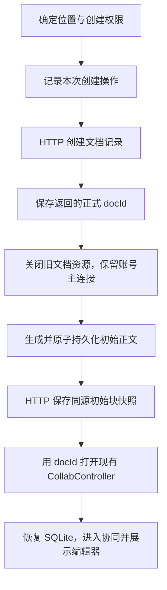

# 手机端新建正式空白文档方案

- 整理日期：2026-10-22。
- 状态：核心代码及本地回归已完成；iOS完整App受现有SwiftPM解析阻塞，真实业务服务及在线双端待验收。
- 目标：创建一份正式空白文档，完成业务建档和初始正文保存，随后进入现有协同编辑页；失败时能够继续完成同一份文档。
- 依据：2026-10-22 对手机端、桌面端当前源码及 BlockCraft 发布产物的核对。本文归档不新增功能验证结论。
- 版本核对记录：[BlockCraft 版本跟踪](block-adaptation.md#blockcraft-版本跟踪)。

## 1. 当前代码与方案基础

| 当前实现 | 对方案的影响 |
|---|---|
| 已拆出 `DocumentEditorController`、`DocumentEditorView` | 编辑会话和展示可以复用；正式文档的数据初始化仍交给协同层 |
| `LocalEditorController` 已支持独立内存编辑 | 正式新建直接初始化 BlockCraft 数据，避免后续再转换本地编辑树 |
| `CollabController` 仍管理正式文档、SQLite 和协同 | 新建完成后继续使用它，无需另做编辑页面 |
| Rust 仍是进程级单文档 | 旧文档关闭、初始正文准备、新文档打开必须串行 |
| Demo 仍使用固定 docId | 宿主和状态面板需要接收动态文档身份 |
| 桌面已 `await diffStoreSnapshot()` | 手机也应等待初始 HTTP 请求并检查业务结果 |
| 桌面空间列表增加默认空间初始化 | 首次使用时需要处理个人空间尚未创建的情况 |

主要源码依据：

- [手机独立编辑会话](../packages/cses_document_collab/lib/src/editor/core/document_editor_controller.dart)。
- [手机编辑视图](../packages/cses_document_collab/lib/src/editor/document_editor_view.dart)。
- [手机本地编辑控制器](../packages/cses_document_collab/lib/src/editor/local_editor_controller.dart)。
- [手机正式文档控制器](../packages/cses_document_collab/lib/src/controller/collab_controller.dart)。
- [手机 Demo 宿主](../lib/src/demo/document_host.dart)。
- [手机原生协同接口与持久化](../packages/cses_document_collab/rust/src/api/collab.rs)。
- [手机正式 BlockCraft 模型适配](../packages/cses_document_collab/rust/src/api/blockcraft.rs)。
- [桌面文档创建与快照保存](../../cses-client/packages/docs/src/document-content/doc.service.ts)。
- [桌面初始块快照转换](../../cses-client/packages/docs/src/document-content/snapshot-insert-diff.ts)。
- [桌面空间列表及默认空间初始化](../../cses-client/packages/docs/src/entity-catalog/entity.service.ts)。

桌面源码链接按当前工作区布局指向同级 `cses-client` 仓库；这些源码会继续变化，实施前应重新核对。

### 1.1 BlockCraft 版本基线

| 项目 | 本轮核对结果 |
|---|---|
| 桌面根依赖声明 | `0.11.24` |
| 桌面 Yarn 锁定 | `0.11.24` |
| 桌面实际安装 | `0.11.21` |
| 桌面 docs 包声明 | `^0.11.0-alpha` |
| 历史 pnpm 锁定 | `0.2.78` |
| 桌面配置仓库 `latest` | `0.11.27` |

已读取安装版及完整性校验通过的 `0.11.24`、`0.11.27` 发布包技能、迁移说明和受影响实现。三版 `RootBlockSchema`、`ParagraphBlockSchema`、editable 快照工厂的实现片段一致。

本方案不升级桌面依赖，也不代表上游其他 Schema、行内对象、选区菜单、剪贴板、输入、历史和协同能力已经完成手机适配。

## 2. 用户操作流程与首期范围

首期提供“新建空白文档”入口：

1. 显示“新建到”的位置。
2. 从空间或文件夹进入时继承当前位置；Demo 默认读取个人空间。
3. 点击“创建”后显示进度，禁止重复提交。
4. 初始正文保存成功后打开文档。
5. 打开后通过现有标题栏改名。

创建时沿用桌面的空名称 `name: ''`，界面显示现有未命名占位。

首期完成正式空白文本创建。模板、离线建档及完整文档库管理后续接入。位置能力由宿主提供，创建命令接收明确的 `targetId`，不把个人空间 ID 写死在协同包中。

## 3. 完整创建调用链



| 阶段 | 行为及完成条件 |
|---|---|
| 位置预检 | 确认目标存在，并读取创建子资源的权限；服务端最终鉴权 |
| 创建记录 | 调用 `/doc/document/create`，检查业务成功且返回有效 docId |
| 保存进度 | 持久化 docId、目标位置和当前阶段，保证后续失败能够续跑 |
| 准备正文 | 在原生层生成正式根块及空段落，提交到 SQLite |
| 保存快照 | 调用 `/doc/document/edit`，等待并检查接口约定的成功结果 |
| 打开文档 | 创建正式控制器，恢复同一份已落盘的 CRDT 数据 |
| 进入协同 | 复用现有 Gateway 和状态向量交换；界面持续展示同步状态 |

HTTP 建档请求的核心参数：

```json
{
  "name": "",
  "documentType": "text",
  "targetId": "选定的空间或文件夹ID"
}
```

拿到 docId 后，后续失败只继续处理这份文档，不再重新调用建档接口。HTTP 成功必须检查业务返回，不能仅以传输层成功或 Future 正常结束作为依据。

## 4. 初始正文结构与数据一致性

正式文档初始化为两个块：

```text
blocks
├── docId
│   ├── flavour: root
│   ├── nodeType: root
│   ├── props: {}
│   ├── meta: 桌面根块的创建时间及修改时间结构
│   └── children: [paragraphId]
└── paragraphId
    ├── flavour: paragraph
    ├── nodeType: editable
    ├── props: {depth: 0}
    ├── meta: {}
    └── children: 空 Y.Text
```

必须保持以下约束：

- 根 ID 使用服务端返回的 docId；段落 ID 生成一次并持久化。
- 根的 `children` 使用共享数组，段落正文使用 `Y.Text`；块本身及 `props`、`meta` 遵循桌面共享类型结构。
- 根元数据按桌面 Schema 保存 `createdTime` 及 `lastModified`，时间值随初始化结果保存，恢复时不重新生成。
- 空正文不写入占位文字或额外换行。
- 标题、图标、封面继续使用业务元数据。
- 创建初始化不进入用户撤销历史；首次撤销只影响用户编辑。
- 初始正文只生成一次，恢复时复用已落盘的 CRDT 增量，而非重新生成内容相同的共享类型。

HTTP 初始快照从同一份原生模型生成：

- 根块保存子 ID 数组，`parentId` 为 `null`。
- 段落的 `parentId` 为 docId，转换为 `content: []`、`text: ''`。
- 两个块均采用桌面的 `Insert` 语义。

Dart 和 Rust 不各自生成一套初始块。HTTP 快照与协同增量必须来自同一份初始化结果。

## 5. 模块职责与拟议接口

下表对应已落地的模块；具体代码位置与验证进度见第12节。

| 模块 | 建议职责 |
|---|---|
| 宿主 `CsesDocumentCreationService` | 位置、权限、Common HTTP 建档及初始快照请求 |
| 宿主 `DocumentCreationCoordinator` | 串行执行流程、维护进度、防重复、失败恢复和导航 |
| 宿主 `DocumentCreationStore` | 保存账号隔离的创建操作记录 |
| 包内 `DocumentBootstrapper.prepareBlank()` | 独占原生资源，准备并持久化正式空正文，返回不可变快照 |
| Rust 初始化命令 | 检查初始化资格，在事务中生成共享结构及本地初始化标记 |
| 现有 `CollabController` | 打开已准备好的文档，负责投影、编辑及协同 |

### 5.1 短生命周期的正文准备能力

建议为新建提供独立的正文准备能力：

1. 准备阶段不启动协同、不创建编辑视图。
2. 复用现有原生所有权保护，串行准备正文。
3. 完成准备后释放本次准备资源。
4. HTTP 成功后，由现有控制器重新打开相同 SQLite 分区。
5. 重新打开恢复原增量，不重新生成 Yrs 文档内容。

这样保留 `CollabController.initialize()` 当前“打开和恢复文档”的职责，普通打开流程不需要了解业务建档请求。

### 5.2 包与宿主边界

- 宿主只通过 `package:cses_document_collab/cses_document_collab.dart` 的公开接口调用。
- 原生 FRB 类型及内部 EditorState 不作为宿主编排契约。
- Common、账号、Cookie、目录和业务 HTTP 接口留在宿主。
- 包内只接收显式身份配置及借用端口，不反向依赖 Demo 或全局业务上下文。
- `DocumentMetadataService` 保持现有元数据读写职责，创建服务单独设置。

### 5.3 初始化资格与既有文档保护

- 正式空正文准备只能由已获得建档成功结果的操作触发。
- 重复准备必须核对 operationId、docId、初始化标记及当前正文。
- 同一操作恢复时复用既有初始化结果。
- 已有正文或来源不同的初始化结果不得被清空、覆盖或追加空段落。
- 普通打开、清缓存、同步超时及远端缺根继续保留现有等待或报错语义，不触发空正文创建。

## 6. 位置与权限

最新桌面的 `getSpaceList()` 已包含“读取空间 → 初始化缺失默认空间 → 重新读取”的流程。手机需要覆盖首次登录没有个人空间的情况。

建议处理规则：

- 默认目标通过真实空间列表取得。
- 缺少个人空间时，按服务端契约调用初始化接口，再重新查询。
- 对明确传入的空间或文件夹读取 `createChild` 权限。
- 服务端拒绝创建时保留位置选择并展示原因。
- 新文档的编辑授权来自创建结果及后续权限读取，调整 Demo 中无条件 `editable: true` 的使用方式。

创建后详情接口可能存在短暂延迟。若沿用桌面的创建者权限缓存，应限制在当前账号、当前 docId 和本次创建操作内，并由正式权限响应替换；明确拒绝时立即撤权。

创建者初始权限契约及默认空间初始化的业务权限，需要在真实服务联调中确认。

## 7. 创建进度与失败恢复

创建过程跨越 HTTP、SQLite 和协同，无法由一个事务覆盖，需要一份小型操作记录。

### 7.1 操作记录

建议记录：

- `operationId`。
- 服务端、企业、用户身份。
- `targetId`。
- 已知的 `docId`。
- 稳定的 `paragraphId` 和初始化时间。
- 当前阶段、最近失败及快照摘要。

凭证不写入操作记录。原生初始化标记与初始增量在同一 SQLite 事务中提交，避免进程退出后无法判断正文是否已经生成。

宿主操作记录与原生准备结果之间的中断，通过恢复时核对原生初始化标记处理；不能仅凭宿主阶段落后就再次生成正文。

### 7.2 失败分类

| 失败位置 | 恢复策略 |
|---|---|
| 预检失败 | 修正位置或权限后重新提交 |
| 创建明确被拒绝 | 不生成正文，允许用户重新操作 |
| 创建超时、未拿到 docId | 标记结果不明，停止自动重发创建 |
| 已拿到 docId，正文准备失败 | 继续准备这份文档 |
| 正文已落盘，HTTP 请求失败 | 保留原 ID、原增量，核对服务端状态后继续 |
| HTTP 已成功，打开页面失败 | 只重新打开该 docId |
| 协同连接失败 | 保留本地正文，使用现有重连机制 |

本地 operationId 只能防止客户端重复执行。服务端是否支持幂等键，目前没有代码依据；确认前不能承诺创建请求超时后的自动重试不会产生重复文档。

HTTP 快照重试也不能默认重复 `Insert` 安全。结果不明时先回读核对；已经存在或被其他客户端修改的正文进入恢复流程，避免覆盖。

### 7.3 取消与离线

- 首次正式建档要求联网。
- 创建完成后的离线编辑沿用现有能力。
- 已发送请求的取消不等于服务端取消建档。
- 已获得 docId 的文档保留，后续提供继续完成入口，不自动删除。
- 创建过程中退出页面，停止后续导航，但仍需接收并正确归属已发请求的结果。

## 8. 文档切换、连接及账号生命周期

当前 `DemoDocumentHost.close()` 最终会关闭它持有的主连接。新建文档需要明确区分文档级切换与账号级退出。

文档切换顺序：

1. 将旧编辑视图移出组件树。
2. 等待旧 `CollabController.close()` 完成。
3. 保留已登录账号和 Common 主连接。
4. 执行新文档准备。
5. 打开新控制器并安装编辑视图。

退出登录时才执行账号级连接关闭。

旧控制器的关闭已等待业务请求、权限切换、会话及投影，继续复用这套顺序。原生准备过程也遵循相同独占资源约束，不同时打开两个原生正式文档。

创建期间退出页面或切换账号时，迟到响应仍记录到原账号操作中，但不得打开页面、更新新账号列表或发送新的正文请求。已经创建的服务端文档保留，后续提供继续完成入口。

## 9. HTTP 与协同的完成边界

方案保留桌面的两条链路：

- HTTP 初始块快照。
- PaaS 的 Yjs/Yrs 正文协同。

两者必须使用同一份初始化结果。上线前需要真实确认 `/doc/document/edit` 的后端行为：它是否只保存块快照，还是还会独立生成协同根。

如果服务端已经生成权威 CRDT 根，客户端应恢复那份状态。仅凭 docId、paragraphId 相同，不能认定两份独立创建的共享类型可以安全合并。首次同步发现不同来源的已有正文时，应停止自动补传并进入恢复。

### 9.1 界面状态语义

| 状态 | 可以表达的含义 |
|---|---|
| 建档接口成功 | 文档记录已创建 |
| SQLite 提交成功 | 正文已保存在本机 |
| HTTP 业务成功 | 初始快照请求已被业务接口接受 |
| 协同 `ready` | 本机完成本轮差量处理和发送 |
| 独立客户端回读成功 | 已验证该客户端能取得一致内容 |

当前协议没有正文持久化 ACK，`ready` 不能用作“服务器已落库”的依据。

### 9.2 实施前与上线前需要确认的服务端契约

| 契约 | 当前状态及处理原则 |
|---|---|
| 创建接口幂等能力 | 尚未确认；结果不明时不自动重发创建 |
| 初始块快照重复 Insert 语义 | 尚未确认；重试前回读核对 |
| HTTP 快照与 PaaS 根初始化来源 | 需要真实联调；避免独立构造冲突 CRDT 根 |
| 创建者初始权限及权限读取延迟 | 需要真实联调；初始权限不能扩散到其他账号或文档 |
| 默认个人空间初始化 | 对齐桌面路由并验证真实业务权限与返回格式 |
| 服务端正文持久化确认 | 当前客户端无此 ACK；不以协同 ready 代替 |

这些是待验证契约，不是已经具备的服务端能力。

## 10. 实施步骤与验收

### 第一步：原生初始化与兼容测试

实现正式根、空段落、初始化标记及原子持久化。

重点验证：

- 生成结构可被桌面发布版读取。
- 空段落可以正常输入，初始化不进入用户撤销历史。
- 持久化失败不改变权威状态。
- 重开不增加段落，重复准备不重建 CRDT。
- 已有正文、不同操作及普通缺根打开受到保护。
- 原生资源按所有权释放，不影响其他控制器。

### 第二步：宿主创建服务与恢复记录

接入位置、权限、建档和快照请求。

重点验证：

- 重复点击与同一操作重复执行。
- 明确业务拒绝与超时结果不明。
- 拿到 docId 后各阶段失败，恢复时不再次建档。
- 本地阶段标记落后于原生初始化结果。
- 初始 HTTP 请求业务结果核验及重试前回读。
- 进程退出、页面退出、账号切换及迟到响应。

### 第三步：动态文档入口与手机页面

宿主、状态面板使用真实 docId，接入新建入口、进度、继续完成、标题编辑和返回后的列表刷新。

重点验证：

- 位置继承、首次个人空间初始化与创建权限。
- 创建期间重复提交和返回操作。
- 新文档名称占位、打开后改名及权限刷新。
- 切换文档时旧视图、旧控制器和新控制器的关闭打开顺序。
- 主连接在文档切换时保留，退出登录时关闭。
- 窄屏、系统大字、键盘及错误状态下操作可达。

### 第四步：真实双端与平台验收

重点验证：

- 手机创建后桌面能打开，块 ID 和空正文一致。
- 手机与桌面双向编辑、撤销及重新打开。
- 关闭创建端，使用独立缓存客户端回读，排除仅本机恢复的伪成功。
- HTTP 快照与 PaaS 正文初始化衔接及既有正文冲突。
- 断网重连、应用重启与继续完成创建。
- Android、iOS 分别验证。

模拟接口测试不能替代真实服务和双端验收；独立客户端回读也不能代替数据库持久化 ACK。

### 工程验证要求

- 按包 README 的固定版本和命令重新生成 FRB，不手工修改生成文件。
- Rust 执行受影响 crate 的 `cargo fmt --check`、`cargo check` 和相关测试。
- 修改的手写 Dart 文件执行 `dart format`。
- 在协同包及受影响宿主范围运行静态分析和目标测试。
- 包级公开接口变更同步验证消费者。
- 重建受影响原生库，并验证 Android、iOS 构建及桥接。
- 检查导出、旧名与跨包实现导入，执行 `git diff --check`。
- 同步更新包 README、创建功能验证记录和 BlockCraft 版本跟踪。

## 11. 当前交付边界

已实现正式正文准备、宿主HTTP建档与快照保存适配、账号隔离恢复记录、动态docId入口、创建页面、
文档切换与权限刷新。根冲突会在协同补传前拒绝，并保留本地内容。

真实服务的建档幂等能力、HTTP快照与PaaS根来源、创建后权限传播及正文持久化确认仍待联调。
结果不明的请求采用保守恢复，不盲目重复建档或Insert。没有自动删除已创建的服务端文档。

## 12. 落地代码与验证进度

| 范围 | 代码 |
|---|---|
| 业务接口 | [CsesDocumentCreationService](../lib/src/demo/document_creation/cses_document_creation_service.dart) |
| 创建编排及恢复阶段 | [DocumentCreationCoordinator](../lib/src/demo/document_creation/document_creation_coordinator.dart)、[操作记录](../lib/src/demo/document_creation/document_creation_operation.dart) |
| 账号隔离持久化 | [FileDocumentCreationStore](../lib/src/demo/document_creation/document_creation_store.dart) |
| 手机创建页面 | [DocumentCreationPage](../lib/src/demo/document_creation/document_creation_page.dart) |
| 文档切换与动态身份 | [DemoDocumentHost](../lib/src/demo/document_host.dart)、[入口页面](../lib/src/demo/collab_demo_page.dart) |
| 包级公开准备端口 | [DocumentBootstrapper](../packages/cses_document_collab/lib/src/controller/document_bootstrapper.dart)、[PreparedDocument](../packages/cses_document_collab/lib/src/model/prepared_document.dart) |
| 原生事务及根来源保护 | [document_bootstrap.rs](../packages/cses_document_collab/rust/src/api/document_bootstrap.rs) |
| 设备隔离流程验证 | [集成测试](../integration_test/document_creation_device_test.dart) |

FRB使用与仓库一致的2.13.0生成；未采用本机旧2.12生成器自动引入的依赖降级。
具体测试结果、平台构建及未验收范围以本轮验证记录为准，不能把隔离HTTP替身验证视为真实业务服务通过。

当前实现以服务端、企业、用户的SHA-256文件分区绑定创建记录；失败文案只在内存展示，恢复时按持久化阶段重新核对。
原生初始化重试同时核对向量及删除集合，避免漏检纯删除。正式文档先恢复只读缓存，再独立读取权限；未启用乐观owner缓存。

已通过宿主40项、协同包目标21项、Rust106项及latest发布包对应3项真实原生/桌面数据层互通回归。
Android调试APK及iOS三架构原生库构建通过；iOS完整设备流程未执行到断言，真实服务和在线双端仍待验收。
详见[实施与验证记录](verification/document-creation-20261022/report.md)及[机器可读结果](verification/document-creation-20261022/validation.json)。

### 提交审查后的修复

首次创建意图只有落盘成功后才安装；创建结果不明仍不自动重发，页面提供核对勾选后“结束此次记录”的明确出口，reviewed持久化成功后才允许下一项独立创建。Common适配借用原有Dio保留网络异常与HTTP状态，避免把超时误当业务拒绝。

已有正式缓存先只读恢复，不等待权限HTTP；明确授权后开放编辑，手动/前台恢复可刷新授权，初始化早期失败可重试，关闭和账号切换拒绝迟到结果。原生重试校验覆盖仅删除的变化，保留旧标记格式和原正文。

具体修复与新增验证以[修复记录](verification/document-creation-20261022/review-fixes.md)为准；上方40/21/106和平台结果保留为首次实现的历史记录。

### 创建页空间文档列表

创建按钮已移至右上角；页面按选中空间加载可见直接子文档，显示标题、所有者和修改时间，支持刷新、分页、空列表及失败重试。沿用客户端与Java后端的`POST /doc/document/list`契约：父节点字段为`id`，分页从1开始，使用`totalCount`判断下一页。

列表由独立Sliver组件惰性构建，切换空间忽略旧响应，挂起创建始终展示其固定位置；列表失败不阻断独立创建。未知结果的核对结束动作仍保留，完整文档库、目录管理及已有文档打开不属于本轮新增范围。

74项关联回归、目标静态分析及Android调试构建通过，具体依据和未验收范围见[空间列表记录](verification/document-creation-20261022/space-document-list.md)。此前实现与审查修复的测试数字保留为历史记录。

空间响应乱序的P2已修复：恢复记录读取后即固定本次位置，迟到响应及失败后重试仅补全空间选项；新页面不会继承上一项已完成操作的位置。3项新增回归及本轮51项目标验证见[修复记录](verification/document-creation-20261022/space-document-list-p2-fix.md)。

位置选项并发重试使用唯一在途令牌，同一帧重复回调也不会重复请求；加载同步显示进度，成功/失败回写检查有效性，退出后失效，失败后可继续重试。4项新增回归及55项目标验证见[并发重试修复](verification/document-creation-20261022/space-document-list-retry-fix.md)。
