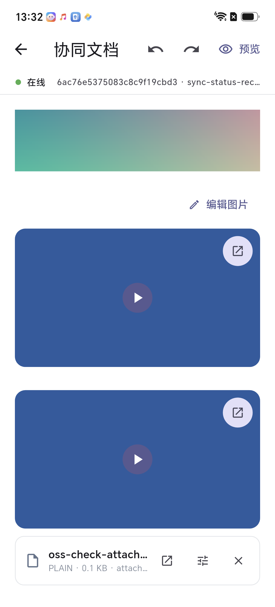
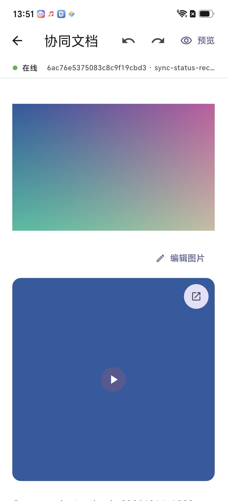

# OSS 上传联调记录

日期：2026-10-14。环境：CSES PRE；Android 真机 MTN AN00，Android 16。

测试文档：`6ac76e5375083c8c9f19cbd3`。测试内容位于末尾 `OSS-check-20261014` 区域，使用专门生成的文件。

## 结果

| 类型 | 原文件 | 字节数 | OSS 回读 | 与原文件 SHA-256 比较 | 服务端文档 |
|---|---|---:|---|---|---|
| 图片 | `oss-check-image-20261014.png` | 33105 | 200 / image/png | 一致 | image 块，`props.src` 正确 |
| 视频 | `oss-check-video-20261014.mp4` | 11866 | 200 / video/mp4 | 一致 | video 块，`props.url` 正确 |
| 附件 | `oss-check-attachment-20261014.txt` | 111 | 200 / text/plain | 一致 | attachment 块，URL、名称、大小、类型正确 |

图片和视频通过真机底部面板及系统文件选择上传。Android 系统视频选择器将视频显示名改为 `1000015411.mp4`，回读内容与原始 MP4 一致。

附件通过应用私有缓存中的测试文件调用同一 `CsesEditorMediaUploadService` 和正式资源插入事务验证；本次没有单独完成附件系统文件选择器的交互验收。联调时直接使用 Downloads 路径出现请求体 0 字节错误，改用应用私有缓存文件后上传成功；本次附件验证未单独覆盖系统文件选择器的授权和文件交付交互。

三项均使用 Common 的 OSS 客户端和 fileDrive 登记接口，上传服务仅在两步成功后返回 URL。随后使用独立订阅和空状态向量重新拉取服务端完整 Yjs 文档，以新建 Y.Doc 解码核对，排除仅观察本机 SQLite 缓存的情况。三块按图片、视频、附件顺序出现在文档根列表中。附件元数据为：

```json
{"name":"oss-check-attachment-20261014.txt","size":111,"type":"text/plain"}
```

## 修复的问题

1. Demo 的密码登录和 WebSocket 使用独立地址，原宿主没有初始化 Common 的 REST `baseUrl`，上传在获取 OSS 凭证前失败。现在先加载 Common PRE 配置，再将完整成功响应交给 `User().resolveContext(value)`，统一初始化身份、企业、权限、媒体站点和域名。旧内存会话缺少响应时，可通过已有会话调用 `/User/auth` 恢复上下文；不保存密码或登录账户快照。
2. 未传入媒体站点时，`/oss/readOssConfig` 返回 500。正式上下文解析后，站点由服务端响应提供。
3. 新资源替换空段落时，适配器的位置回退将其识别为旧块转换，导致附件初始化元数据丢失。插入前为资源指定独立协同 ID 后，服务端回读已确认名称、大小和类型保留。先前的无元数据测试附件块已移除。

## 登录接入后续调整（2026-10-14）

登录入口现已统一使用 Common `HttpManager` 的 Dio：在请求前加载 PRE 配置和设备信息，成功后立即调用 `User().resolveContext`。文档宿主直接读取 Common 当前上下文，不再保存完整响应、覆盖身份/地址或通过旧内存响应回退调用 `/User/auth`。以上联调结果记录的是当时实现；本次登录调整的根宿主 18 项自动测试通过（包含本机真实 Common WebSocket 回环），涉及 App 代码和测试的静态检查通过；该阶段尚未重新进行真实 OSS 上传验收；后续真机复验结果见下节。

## Common 统一登录后的真机复验（2026-10-14）

环境：Android 真机 MTN AN00 / HONOR X70，Android 16，PRE。使用用户提供的测试账号从新版 Demo 登录页登录。

### 登录与连接

首次真机登录在 `ctx.updateDeviceInfo()` 阶段出现 `MissingPluginException`：Demo Android 宿主只提供 `getDeviceId`，缺少 Common 需要的 `getCpuModel` 和 `getCpuInfo`。已复用 CSES Android 宿主的 `DeviceInfoMethodHandler` 实现补齐设备通道，保留原设备 ID 契约，并在 CPU 信息读取失败时使用系统兜底；重新构建并安装后登录通过。

Common 运行时核对结果：用户、企业、当前企业对象与 Cookie 均有效；站点为 `jqdl`；HTTP 地址为 `https://api-pre.jinqidongli.com`，主连接地址为 `ws://ws-pre.jinqidongli.com/ws`。版本为 `1.0.0`，系统信息为 `HONOR MTN-AN00 Android 16`，CPU 信息为 `SM6650 ARMv8.6`。媒体域名来自服务端响应。

主连接 transport/hello ready 均为 true，HTTP/Common 上下文与 WS 的设备、企业和 Cookie 一致。文档收到 `collabSync`、`collabSyncStatus`，编辑页显示在线，控制器为 online、可编辑且 error=null。新资源插入后本机块数为 146。

### 图片和视频

| 项目 | 原文件 | 字节数 | OSS 回读 | SHA-256 比较 | 服务端文档 |
|---|---|---:|---|---|---|
| 图片 | `common-login-check-20261014.png` | 33105 | 200 / image/png | 与原文件一致 | `image`，块 ID `c-OOzX`，根列表位置 131（从 0 开始） |
| 视频 | `common-login-check-20261014.mp4` | 11866 | 200 / video/mp4 | 与原文件一致 | `video`，块 ID `huQayt`，根列表位置 132（从 0 开始） |

两项均通过真实页面的“本地上传 → 系统选择器 → 上传并插入”完成，包含 OSS 上传与 fileDrive 文件登记。视频选择器将显示名改为 `1000015430.mp4`，内容与原 MP4 相同。点击新视频的播放按钮后，界面出现暂停按钮；原生播放器 initialized=true、error=null，进度到达 1000/1000 毫秒，确认一秒测试视频播放完成。

新测试内容位于原 `OSS-check-20261014` 区域附近，文字标记为 `Common-login-check-20261014-1328`。测试图片和视频保留在文档中，便于人工复核。使用独立 Common 路由实例、空状态向量重新请求服务端完整 Yjs 文档，得到 58005 字节 update；以新的 Y.Doc 解码确认以上 URL、flavour 和根列表位置，证明结果已回到服务端，未以本机缓存代替。

结果摘要与原文件 SHA-256 见 [验证数据](verification/common-login-upload-20261014.json)，界面见下图。记录不含密码、Cookie、OSS 临时凭证或完整登录响应。



### 范围与异常记录

Android debug APK 构建通过，根宿主 18 项回归测试通过。普通页面登录、图片/视频上传、插入和视频播放均通过。本轮不覆盖其他设备、iOS、大文件、断网重试、音频或封面上传；图片仍为已适配，视频仍为部分支持，剩余桌面工具栏/嵌入能力限制不变。

调试器通过 VM Service 对 CollabController 实例执行内部编辑事务时，应用出现 SIGSEGV 并退出；该调试调用未用于本轮正常交互验收。重启后通过真实页面操作完成全部验证，正常页面流程未复现；此调试调用异常尚未定位，不能据此断言所有编辑或调试路径均无问题。

## 宿主直接注入文档配置后的真机复验（2026-10-14）

宿主已移除重复的连接配置类型和缓存键计算。`DemoDocumentHost` 在创建 `CollabDocumentConfig` 时直接从 Common 的 `ctx.websocketHost`、`User().companyId`、`User().userId` 和展示名取值；Cookie 留在 Common，文档配置只持有不可变身份和存储参数，协同包统一计算缓存键。登录成功前仍校验 Common 身份和主连接地址，不把校验迁移为另一套配置对象。

新版 APK 在同一台 MTN AN00 / Android 16 真机重新安装并使用测试账号登录。运行时确认已删除配置的库不再加载，文档配置的用户、企业、服务端与 Common 完全一致，固定 docId 正确；主连接 ready=true，设备、企业和 Cookie 均与 Common 一致。文档初始化恢复既有 146 块，测试插入后为 150 块，仍为 online、可编辑、error=null。最终源码重新构建、安装后再次登录，身份/地址仍与 Common 一致，文档 online、150 块、error=null，两项上传资源均成功恢复；最终源码指纹核对一致。

| 项目 | 原文件 | 字节数 | OSS 回读 | SHA-256 比较 | 服务端文档 |
|---|---|---:|---|---|---|
| 图片 | `direct-context-check-20261014.png` | 33105 | 200 / image/png | 与原文件一致 | `image`，块 ID `fO5lBm`，根列表位置 131（从 0 开始） |
| 视频 | `direct-context-check-20261014.mp4` | 11866 | 200 / video/mp4 | 与原文件一致 | `video`，块 ID `p6Ew3w`，根列表位置 132（从 0 开始） |

两项通过真实页面的本地上传、系统选择器、上传并插入完成，包含 Common OSS 与文件登记。视频选择器显示名为 `1000015434.mp4`；点击新视频播放后，原生播放器初始化成功，进度达到 1000/1000 毫秒，error=null。测试区域文字为 `direct-context-check-20261014`，资源保留供人工复核。

独立 Common 路由使用空状态向量重新拉取服务端文档，得到 59390 字节 update；以新的 Y.Doc 解码确认新资源的 URL、flavour 和根列表位置。回读未依赖本机 SQLite，证明服务端协同状态已包含本次插入，不代表额外的数据库落库 ACK。

16 项根宿主测试通过，覆盖登录、失败重试、页面销毁后的迟到响应、文档初始化失败清理、Common 真实 Socket 回环、原缓存键固定值和服务端/企业/用户/文档分区隔离；连接地址 query、fragment、内嵌凭证和错误协议校验迁入登录测试。相关静态检查和 Android debug 构建通过。旧类及相关 getter、import、测试文件引用均已清理，根 App 不再直接依赖 crypto。

验证摘要与哈希见 [验证数据](verification/direct-context-upload-20261014.json)，截图见下图。本轮仍仅覆盖 Android、小型测试图片和一秒视频；iOS、大文件、断网重试、音频和封面不在本轮范围。图片已适配、视频部分支持及剩余桌面工具栏/嵌入限制保持不变。



## 回归与范围

- 根 App 的 15 项测试通过，覆盖完整登录响应保留、Common 上下文解析和 WebSocket 联调。
- 包内 42 项相关测试通过，覆盖资源面板、快捷插入、资源适配器，以及空段落插入必须使用新身份的回归。
- 修改文件的静态检查通过。
- 本次未验证音频、封面的真实上传，也未验证 iOS 上传或大文件压力场景；各块适配状态保持不变。

记录不包含 Cookie、OSS 临时凭证或完整登录响应。
